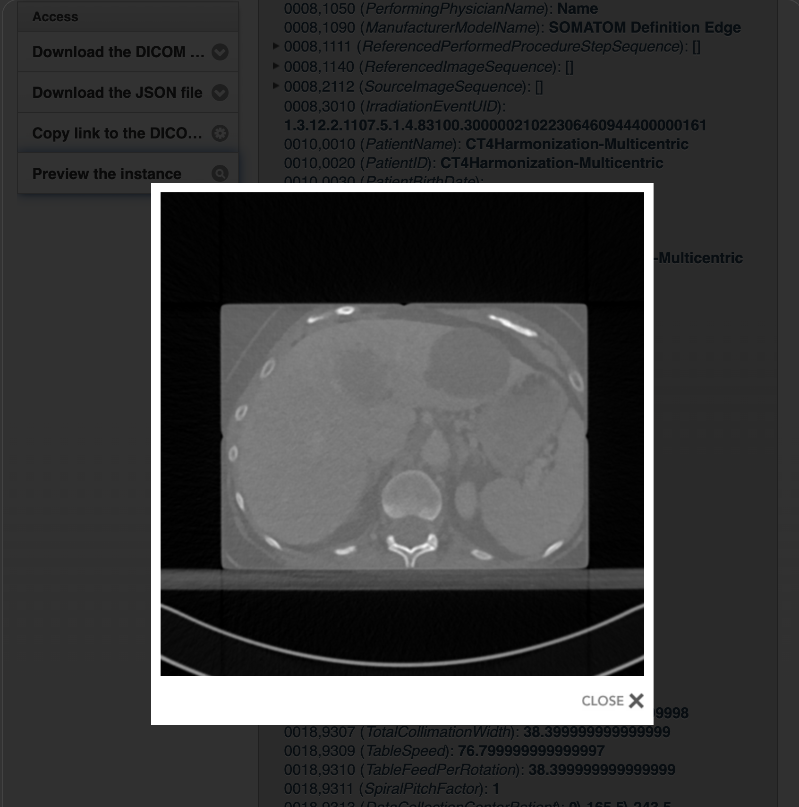
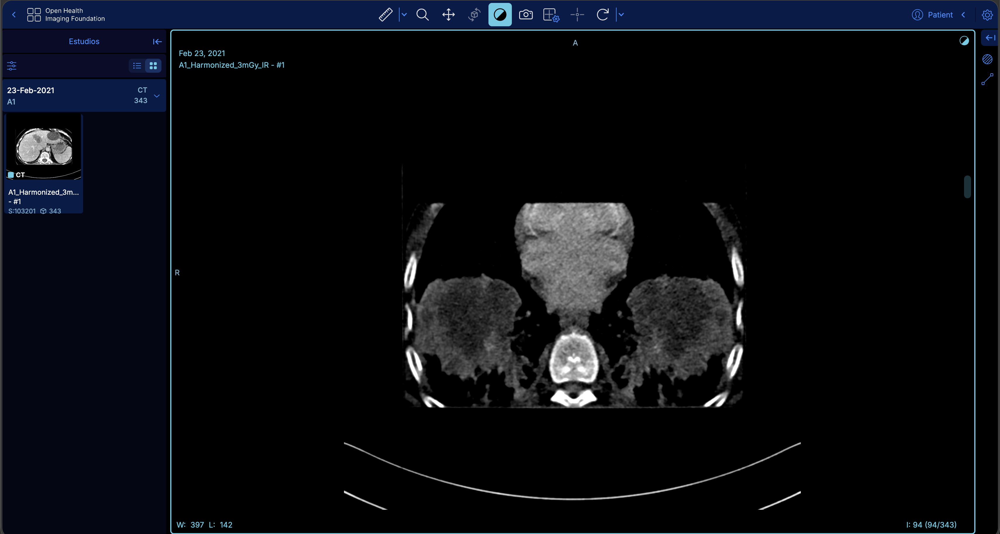

# PACS/DICOM Lab

Hands-on personal project focused on PACS administration, DICOM workflows, DICOMweb integration, and medical-image viewing.

## Objective

Build and validate a local medical-imaging environment to gain practical experience with PACS deployment, DICOM metadata, DICOMweb queries, and clinical image viewing.

## Architecture

```text
Public de-identified DICOM data
            ↓
     Orthanc PACS
            ↓
        DICOMweb
            ↓
       OHIF Viewer
```

## Technologies

- Docker Desktop
- Orthanc PACS
- DICOM
- DICOMweb
- OHIF Viewer
- The Cancer Imaging Archive (TCIA)

## Key activities

- Deployed a local Orthanc PACS using Docker.
- Configured persistent storage for Orthanc data.
- Loaded and inspected a public, de-identified chest CT study.
- Reviewed DICOM metadata at study and series level.
- Verified the DICOM hierarchy: Patient → Study → Series → Instance.
- Queried studies through the DICOMweb API using QIDO-RS.
- Integrated Orthanc with OHIF Viewer to navigate CT slices in a web-based clinical viewer.
- Simulated a PACS outage, identified the data-source connection error in OHIF, and recovered the service.

## Validation

The loaded CT study contained:

- Modality: CT
- Body part examined: CHEST
- Series: `A1_Harmonized_3mGy_IR`
- Instances: 343

DICOMweb availability was verified with:

```bash
curl -u orthanc:orthanc http://localhost:8042/dicom-web/studies
```

## Simulated incident

| Stage | Result |
|---|---|
| PACS service stopped | OHIF displayed a Data Source Connection Error |
| Diagnosis | Orthanc was not running in Docker Compose |
| Recovery | Orthanc was restarted with `docker compose start orthanc` |
| Verification | The CT study opened correctly in OHIF |

## Screenshots





## Data privacy

Only public, de-identified DICOM data were used. No patient data, DICOM files, credentials, or PACS databases are included in this repository.

## Data source and references

- [The Cancer Imaging Archive (TCIA)](https://www.cancerimagingarchive.net/)
- [Orthanc](https://www.orthanc-server.com/)
- [OHIF Viewer](https://ohif.org/)

## Scope

This project is a local learning lab and is not intended for clinical or production use.
